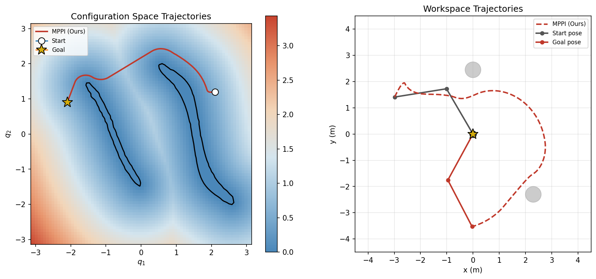
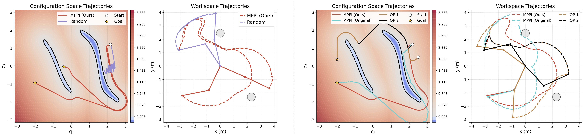
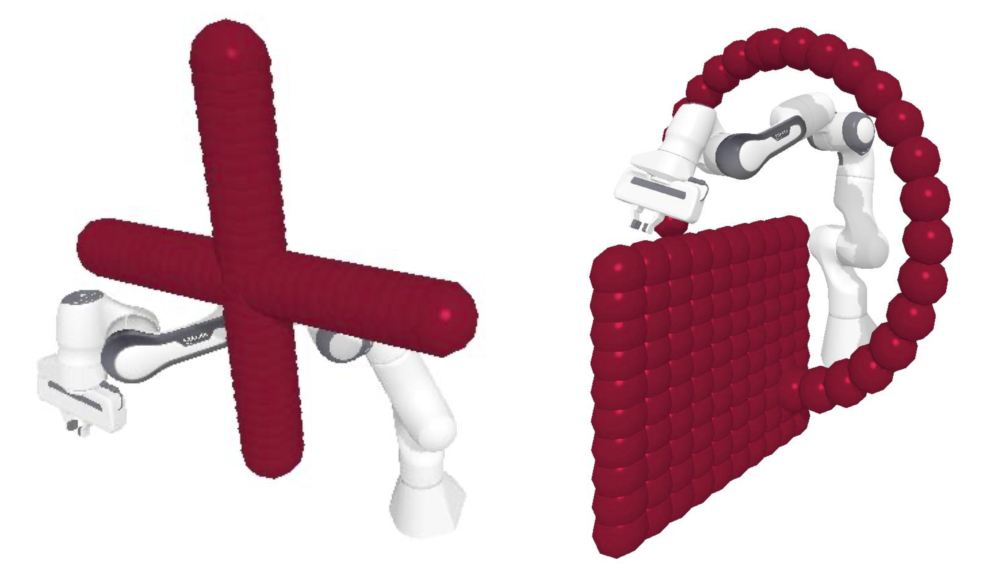
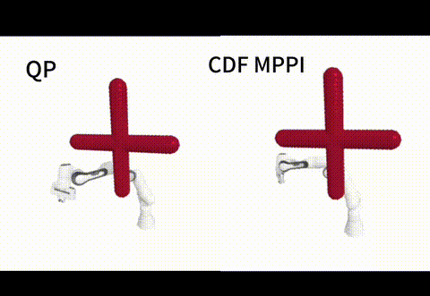
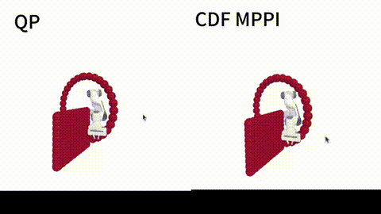

# CDF-MPPI: Motion Planning with Configuration Space Distance Fields

https://arxiv.org/abs/2509.00836
Accepted by ICRA 2026

## Demo

Run the 2D two-link robot demo (generates trajectory plot and animation):

```bash
python -m exp.linkrobot.demo_2d
```

This saves `img/demo_cspace_workspace.png` (configuration space + workspace trajectories) and `img/demo_animation.gif`.

<p align="center">
  
</p>

---

## Installation

### Requirements
- Python ≥ 3.12

```bash
git clone https://github.com/Rin-Li/cdf_mppi.git
cd cdf_mppi
pip install -r requirements.txt
```

> **Note:** `pytorch-minimize` wheels may not exist for all Python/torch versions. If the install fails, install it from source:
> ```bash
> pip install git+https://github.com/rfeinman/pytorch-minimize.git
> ```

### Optional: Franka 7-DOF experiment
The Franka experiment additionally requires PyBullet (already in `requirements.txt`). It also loads a pretrained CDF network from `cdf/model_dict.pt`, which is already included in the repository.

---

## Quick Start

All experiments are launched from `main.py`:

```bash
# 2D two-link robot — CDF-MPPI (default)
python main.py --robot 2d --method cdf_mppi

# 2D two-link robot — original MPPI baseline
python main.py --robot 2d --method mppi

# 2D two-link robot — QP/IPOPT baseline
python main.py --robot 2d --method qp

# 7-DOF Franka robot — CDF-MPPI (requires pybullet)
python main.py --robot franka --method cdf_mppi
```

You can also run each experiment directly:

```bash
python -m exp.linkrobot.cdf_mppi   # 2D CDF-MPPI
python -m exp.linkrobot.mppi_original  # 2D original MPPI
python -m exp.linkrobot.qp_2d      # 2D QP
python -m exp.franka.cdf_mppi      # Franka CDF-MPPI
```

---

## Advantages
- **Avoiding local optima**: The method eliminates optimization-based procedures, reducing the risk of convergence to local minima.  
- **Unified cost function**: An angle-based cost function integrates goal-seeking and obstacle avoidance into a single metric with consistent units.  
- **Computational efficiency**: By leveraging CDF gradients, the MPPI horizon can be reduced to one step ($H=1$), significantly lowering computation time while maintaining safety.  


## Results

### 2D Two-Link Robot
- Success rate: **99.2%**  
- Outperforms QP and original MPPI in robustness  
- Slightly longer but safer trajectories  

<p align="center">
  
</p>

<p align="center">
  <em>Comparison of trajectories in configuration space (left) and workspace (right).</em>
</p>

| Method | Success Rate (%) | Path Length | Avg. Steps |
|--------|------------------|-------------|------------|
| MPPI (Ours) | 99.2 | 5.09 | 241 |
| MPPI (Original) | 71.2 | 4.40 | 155 |
| QP (IPOPT) | 64.1 | 3.75 | 107 |

---

### Real Robot Experiment (UR3e)

<p align="center">
  
</p>

<p align="center">
  <em>GIF: CDF-MPPI deployed on a real UR3e robot arm for obstacle avoidance.</em>
</p>

---

### 7-DOF Franka Robot
- Achieves **>750 Hz** control frequency  
- Significantly higher success rate than QP and original MPPI in challenging environments  

<p align="center">
  
</p>

<p align="center">
  
</p>

<p align="center">
  <em>GIF: Trajectories of CDF-MPPI and QP in the cross-shaped environment. The QP get into the local optimal and stuck in specified configuration.</em>
</p>

<p align="center">
  
</p>

<p align="center">
  <em>GIF: Trajectories of CDF-MPPI and QP in the ring and wall enviornemnt. The QP trajector is not smooth as the CDF-MPPI (it looks jittery).</em>
</p>

<p align="center">
  <em>Comparison of trajectories in two scenarios with the 7-DOF Franka robot.</em>
</p>

| Method | Succ. (%) | Len. | Hz |
|--------|-----------|------|------|
| MPPI (Ours) | 100 / 83.8 | 4.57 / 7.85 | 776 / 718 |
| QP (IPOPT) | 13.0 / 14.0 | 4.30 / 6.74 | 222 / 228 |
| MPPI (Original) | - | - | 61 / 28 |

---
